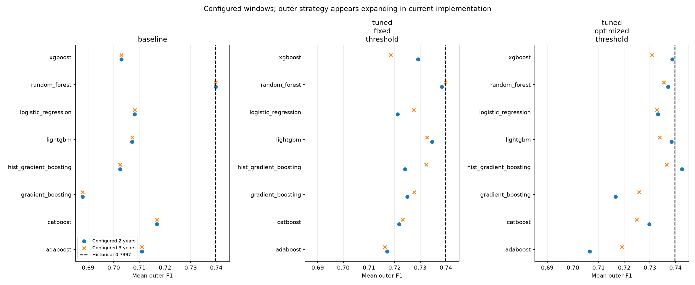

# Saved tuning results do not establish a sliding-window winner

## Executive summary

All 16 requested runs are present and complete (8 models × 2 configured windows; 192 outer metric rows, 960 trial rows). However, the current tuning implementation omits the outer strategy and window arguments, defaulting to expanding-window training. The saved training counts and identical baseline results across configured windows support this concern. These results compare configured inner-window selection procedures on apparently expanding outer training sets; they cannot establish that a 2- or 3-year outer sliding window is preferable.

The historical reference is the user-supplied, rounded F1 of 0.7397. Small numerical exceedances are descriptive, not evidence of a reliable improvement. The strongest observed configurations below are exploratory candidates, subject to selection bias across 16 runs and three approaches.

## Three separate rankings

### baseline

| rank_within_approach | model | configured_window_years | f1_mean | f1_std | precision_mean | recall_mean | pr_auc_mean | roc_auc_mean | delta_f1_vs_historical_rounded |
|---|---|---|---|---|---|---|---|---|---|
| 1.000000 | random_forest | 3.000000 | 0.739730 | 0.013914 | 0.736644 | 0.745864 | 0.834692 | 0.782913 | 0.000030 |
| 1.000000 | random_forest | 2.000000 | 0.739730 | 0.013914 | 0.736644 | 0.745864 | 0.834692 | 0.782913 | 0.000030 |
| 3.000000 | catboost | 3.000000 | 0.716840 | 0.026585 | 0.759017 | 0.691125 | 0.834920 | 0.777277 | -0.022860 |
| 3.000000 | catboost | 2.000000 | 0.716840 | 0.026585 | 0.759017 | 0.691125 | 0.834920 | 0.777277 | -0.022860 |
| 5.000000 | adaboost | 3.000000 | 0.711017 | 0.007658 | 0.738359 | 0.687872 | 0.817291 | 0.764582 | -0.028683 |
| 5.000000 | adaboost | 2.000000 | 0.711017 | 0.007658 | 0.738359 | 0.687872 | 0.817291 | 0.764582 | -0.028683 |
| 7.000000 | logistic_regression | 3.000000 | 0.708140 | 0.020318 | 0.788726 | 0.645913 | 0.836729 | 0.784506 | -0.031560 |
| 7.000000 | logistic_regression | 2.000000 | 0.708140 | 0.020318 | 0.788726 | 0.645913 | 0.836729 | 0.784506 | -0.031560 |
| 9.000000 | lightgbm | 3.000000 | 0.707134 | 0.019080 | 0.760874 | 0.669782 | 0.824448 | 0.762984 | -0.032566 |
| 9.000000 | lightgbm | 2.000000 | 0.707134 | 0.019080 | 0.760874 | 0.669782 | 0.824448 | 0.762984 | -0.032566 |
| 11.000000 | xgboost | 3.000000 | 0.703005 | 0.025745 | 0.760206 | 0.666369 | 0.828296 | 0.770834 | -0.036695 |
| 11.000000 | xgboost | 2.000000 | 0.703005 | 0.025745 | 0.760206 | 0.666369 | 0.828296 | 0.770834 | -0.036695 |
| 13.000000 | hist_gradient_boosting | 3.000000 | 0.702476 | 0.027890 | 0.754878 | 0.666936 | 0.825996 | 0.762905 | -0.037224 |
| 13.000000 | hist_gradient_boosting | 2.000000 | 0.702476 | 0.027890 | 0.754878 | 0.666936 | 0.825996 | 0.762905 | -0.037224 |
| 15.000000 | gradient_boosting | 3.000000 | 0.687849 | 0.045264 | 0.762925 | 0.644361 | 0.821456 | 0.761582 | -0.051851 |
| 15.000000 | gradient_boosting | 2.000000 | 0.687849 | 0.045264 | 0.762925 | 0.644361 | 0.821456 | 0.761582 | -0.051851 |

### tuned_fixed_threshold

| rank_within_approach | model | configured_window_years | f1_mean | f1_std | precision_mean | recall_mean | pr_auc_mean | roc_auc_mean | delta_f1_vs_historical_rounded |
|---|---|---|---|---|---|---|---|---|---|
| 1.000000 | random_forest | 3.000000 | 0.739917 | 0.013041 | 0.737226 | 0.745260 | 0.839804 | 0.786569 | 0.000217 |
| 2.000000 | random_forest | 2.000000 | 0.738411 | 0.016985 | 0.734169 | 0.745978 | 0.839731 | 0.787536 | -0.001289 |
| 3.000000 | lightgbm | 2.000000 | 0.734641 | 0.021544 | 0.752761 | 0.723712 | 0.839733 | 0.783662 | -0.005059 |
| 4.000000 | lightgbm | 3.000000 | 0.732620 | 0.017507 | 0.748660 | 0.721490 | 0.837434 | 0.780810 | -0.007080 |
| 5.000000 | hist_gradient_boosting | 3.000000 | 0.732325 | 0.016732 | 0.727414 | 0.739102 | 0.836681 | 0.779570 | -0.007375 |
| 6.000000 | xgboost | 2.000000 | 0.729103 | 0.016913 | 0.761529 | 0.707638 | 0.838548 | 0.781082 | -0.010597 |
| 7.000000 | gradient_boosting | 3.000000 | 0.727653 | 0.009770 | 0.729052 | 0.728642 | 0.835082 | 0.776005 | -0.012047 |
| 8.000000 | logistic_regression | 3.000000 | 0.727407 | 0.011736 | 0.769101 | 0.693483 | 0.831336 | 0.779228 | -0.012293 |
| 9.000000 | gradient_boosting | 2.000000 | 0.724910 | 0.010641 | 0.757089 | 0.702248 | 0.835712 | 0.777356 | -0.014790 |
| 10.000000 | hist_gradient_boosting | 2.000000 | 0.724051 | 0.016697 | 0.744418 | 0.709679 | 0.840126 | 0.783332 | -0.015649 |
| 11.000000 | catboost | 3.000000 | 0.723112 | 0.015640 | 0.752709 | 0.702190 | 0.839071 | 0.783344 | -0.016588 |
| 12.000000 | catboost | 2.000000 | 0.721753 | 0.016026 | 0.759828 | 0.696116 | 0.837589 | 0.782464 | -0.017947 |
| 13.000000 | logistic_regression | 2.000000 | 0.721123 | 0.013807 | 0.760200 | 0.688167 | 0.830166 | 0.777954 | -0.018577 |
| 14.000000 | xgboost | 3.000000 | 0.718427 | 0.017984 | 0.747170 | 0.700388 | 0.836435 | 0.778482 | -0.021273 |
| 15.000000 | adaboost | 2.000000 | 0.717084 | 0.006170 | 0.733919 | 0.702908 | 0.829632 | 0.772752 | -0.022616 |
| 16.000000 | adaboost | 3.000000 | 0.716176 | 0.001990 | 0.738438 | 0.698011 | 0.824442 | 0.769157 | -0.023524 |

### tuned_optimized_threshold

| rank_within_approach | model | configured_window_years | f1_mean | f1_std | precision_mean | recall_mean | pr_auc_mean | roc_auc_mean | delta_f1_vs_historical_rounded |
|---|---|---|---|---|---|---|---|---|---|
| 1.000000 | hist_gradient_boosting | 2.000000 | 0.742478 | 0.019992 | 0.667118 | 0.841667 | 0.840126 | 0.783332 | 0.002778 |
| 2.000000 | xgboost | 2.000000 | 0.738781 | 0.029860 | 0.689979 | 0.807778 | 0.838548 | 0.781082 | -0.000919 |
| 3.000000 | lightgbm | 2.000000 | 0.738398 | 0.026740 | 0.707596 | 0.779715 | 0.839733 | 0.783662 | -0.001302 |
| 4.000000 | random_forest | 2.000000 | 0.737182 | 0.028143 | 0.674710 | 0.832418 | 0.839731 | 0.787536 | -0.002518 |
| 5.000000 | hist_gradient_boosting | 3.000000 | 0.736495 | 0.020046 | 0.693515 | 0.802078 | 0.836681 | 0.779570 | -0.003205 |
| 6.000000 | random_forest | 3.000000 | 0.735418 | 0.036974 | 0.666149 | 0.843899 | 0.839804 | 0.786569 | -0.004282 |
| 7.000000 | lightgbm | 3.000000 | 0.733840 | 0.022158 | 0.710351 | 0.785664 | 0.837434 | 0.780810 | -0.005860 |
| 8.000000 | logistic_regression | 2.000000 | 0.733150 | 0.024065 | 0.709727 | 0.769924 | 0.830166 | 0.777954 | -0.006550 |
| 9.000000 | logistic_regression | 3.000000 | 0.732759 | 0.028444 | 0.693377 | 0.796663 | 0.831336 | 0.779228 | -0.006941 |
| 10.000000 | xgboost | 3.000000 | 0.730885 | 0.026229 | 0.705734 | 0.773190 | 0.836435 | 0.778482 | -0.008815 |
| 11.000000 | catboost | 2.000000 | 0.729736 | 0.026825 | 0.701957 | 0.786331 | 0.837589 | 0.782464 | -0.009964 |
| 12.000000 | gradient_boosting | 3.000000 | 0.725826 | 0.029843 | 0.673538 | 0.807514 | 0.835082 | 0.776005 | -0.013874 |
| 13.000000 | catboost | 3.000000 | 0.724855 | 0.034405 | 0.670096 | 0.825613 | 0.839071 | 0.783344 | -0.014845 |
| 14.000000 | adaboost | 3.000000 | 0.719128 | 0.046453 | 0.623319 | 0.881535 | 0.824442 | 0.769157 | -0.020572 |
| 15.000000 | gradient_boosting | 2.000000 | 0.716612 | 0.021255 | 0.682816 | 0.804980 | 0.835712 | 0.777356 | -0.023088 |
| 16.000000 | adaboost | 2.000000 | 0.706589 | 0.039867 | 0.660075 | 0.806767 | 0.829632 | 0.772752 | -0.033111 |

## Integrity and temporal interpretation

Discovery used directory time only to bound the requested batch (21:33–22:13 on 11 November 2026). Model identity and window duration were extracted from each saved FULL CONFIGURATION and reconciled with CSV model names. All 16 model/window pairs occur once. All runs contain all four requested files, four outer years, three approaches per year and 15 unique trial IDs per year. No incomplete or duplicate experiment keys were found in this batch. Earlier tuning directories are outside scope, including incomplete earlier runs; they were not substituted into the batch.

Current `src/tune_models.py:462` calls `temporal_cv(df, years, horizon)` without `strategy` or `train_years`. `src/validation.py:64` defaults to expanding windows. The inner-fold builder does read the configured sliding-window duration (unless explicitly overridden). Source snapshots from execution time are absent, so current code is corroborating evidence rather than a definitive historical execution trace. Training-row counts below are identical across all models and configured windows; baseline metric rows are also identical between windows for every model.

| outer_year | train_rows | validation_rows | inner_folds |
|---|---|---|---|
| 2020.000000 | 2578.000000 | 670.000000 | 3.000000 |
| 2021.000000 | 3234.000000 | 782.000000 | 3.000000 |
| 2022.000000 | 4004.000000 | 628.000000 | 3.000000 |
| 2023.000000 | 4705.000000 | 767.000000 | 3.000000 |

The saved configurations retain a 90-day target-label gap and years 2020–2023. The current split code enforces label availability strictly before validation starts. This analysis reads result files and source code only: it does not load raw datasets, access/evaluate 2024, train models, rerun Optuna, or alter the pipeline/configuration.

## Configured 3-year minus 2-year comparisons

Deltas below are in metric units (multiply by 100 for percentage points). They describe saved procedures, not a verified outer sliding-window contrast. PR-AUC here is average precision in the tuning implementation. Fixed and optimized tuned approaches share probabilities, so their PR-AUC and ROC-AUC are identical.

### baseline: mean differences

| model | delta_f1_3y_minus_2y | delta_pr_auc_3y_minus_2y | delta_roc_auc_3y_minus_2y | positive_f1_years |
|---|---|---|---|---|
| adaboost | 0.000000 | 0.000000 | 0.000000 | 0.000000 |
| catboost | 0.000000 | 0.000000 | 0.000000 | 0.000000 |
| gradient_boosting | 0.000000 | 0.000000 | 0.000000 | 0.000000 |
| hist_gradient_boosting | 0.000000 | 0.000000 | 0.000000 | 0.000000 |
| lightgbm | 0.000000 | 0.000000 | 0.000000 | 0.000000 |
| logistic_regression | 0.000000 | 0.000000 | 0.000000 | 0.000000 |
| random_forest | 0.000000 | 0.000000 | 0.000000 | 0.000000 |
| xgboost | 0.000000 | 0.000000 | 0.000000 | 0.000000 |

| model | outer_year | delta_f1_3y_minus_2y | delta_pr_auc_3y_minus_2y | delta_roc_auc_3y_minus_2y |
|---|---|---|---|---|
| random_forest | 2020.000000 | 0.000000 | 0.000000 | 0.000000 |
| random_forest | 2021.000000 | 0.000000 | 0.000000 | 0.000000 |
| random_forest | 2022.000000 | 0.000000 | 0.000000 | 0.000000 |
| random_forest | 2023.000000 | 0.000000 | 0.000000 | 0.000000 |
| catboost | 2020.000000 | 0.000000 | 0.000000 | 0.000000 |
| catboost | 2021.000000 | 0.000000 | 0.000000 | 0.000000 |
| catboost | 2022.000000 | 0.000000 | 0.000000 | 0.000000 |
| catboost | 2023.000000 | 0.000000 | 0.000000 | 0.000000 |
| xgboost | 2020.000000 | 0.000000 | 0.000000 | 0.000000 |
| xgboost | 2021.000000 | 0.000000 | 0.000000 | 0.000000 |
| xgboost | 2022.000000 | 0.000000 | 0.000000 | 0.000000 |
| xgboost | 2023.000000 | 0.000000 | 0.000000 | 0.000000 |
| lightgbm | 2020.000000 | 0.000000 | 0.000000 | 0.000000 |
| lightgbm | 2021.000000 | 0.000000 | 0.000000 | 0.000000 |
| lightgbm | 2022.000000 | 0.000000 | 0.000000 | 0.000000 |
| lightgbm | 2023.000000 | 0.000000 | 0.000000 | 0.000000 |
| adaboost | 2020.000000 | 0.000000 | 0.000000 | 0.000000 |
| adaboost | 2021.000000 | 0.000000 | 0.000000 | 0.000000 |
| adaboost | 2022.000000 | 0.000000 | 0.000000 | 0.000000 |
| adaboost | 2023.000000 | 0.000000 | 0.000000 | 0.000000 |
| gradient_boosting | 2020.000000 | 0.000000 | 0.000000 | 0.000000 |
| gradient_boosting | 2021.000000 | 0.000000 | 0.000000 | 0.000000 |
| gradient_boosting | 2022.000000 | 0.000000 | 0.000000 | 0.000000 |
| gradient_boosting | 2023.000000 | 0.000000 | 0.000000 | 0.000000 |
| hist_gradient_boosting | 2020.000000 | 0.000000 | 0.000000 | 0.000000 |
| hist_gradient_boosting | 2021.000000 | 0.000000 | 0.000000 | 0.000000 |
| hist_gradient_boosting | 2022.000000 | 0.000000 | 0.000000 | 0.000000 |
| hist_gradient_boosting | 2023.000000 | 0.000000 | 0.000000 | 0.000000 |
| logistic_regression | 2020.000000 | 0.000000 | 0.000000 | 0.000000 |
| logistic_regression | 2021.000000 | 0.000000 | 0.000000 | 0.000000 |
| logistic_regression | 2022.000000 | 0.000000 | 0.000000 | 0.000000 |
| logistic_regression | 2023.000000 | 0.000000 | 0.000000 | 0.000000 |

adaboost: mean F1 delta +0.000000; 0/4 years favor 3 years, 0/4 favor 2 years. Largest absolute change is 2020 (+0.000000); excluding that year gives mean +0.000000.

catboost: mean F1 delta +0.000000; 0/4 years favor 3 years, 0/4 favor 2 years. Largest absolute change is 2020 (+0.000000); excluding that year gives mean +0.000000.

gradient_boosting: mean F1 delta +0.000000; 0/4 years favor 3 years, 0/4 favor 2 years. Largest absolute change is 2020 (+0.000000); excluding that year gives mean +0.000000.

hist_gradient_boosting: mean F1 delta +0.000000; 0/4 years favor 3 years, 0/4 favor 2 years. Largest absolute change is 2020 (+0.000000); excluding that year gives mean +0.000000.

lightgbm: mean F1 delta +0.000000; 0/4 years favor 3 years, 0/4 favor 2 years. Largest absolute change is 2020 (+0.000000); excluding that year gives mean +0.000000.

logistic_regression: mean F1 delta +0.000000; 0/4 years favor 3 years, 0/4 favor 2 years. Largest absolute change is 2020 (+0.000000); excluding that year gives mean +0.000000.

random_forest: mean F1 delta +0.000000; 0/4 years favor 3 years, 0/4 favor 2 years. Largest absolute change is 2020 (+0.000000); excluding that year gives mean +0.000000.

xgboost: mean F1 delta +0.000000; 0/4 years favor 3 years, 0/4 favor 2 years. Largest absolute change is 2020 (+0.000000); excluding that year gives mean +0.000000.

### tuned_fixed_threshold: mean differences

| model | delta_f1_3y_minus_2y | delta_pr_auc_3y_minus_2y | delta_roc_auc_3y_minus_2y | positive_f1_years |
|---|---|---|---|---|
| adaboost | -0.000908 | -0.005190 | -0.003595 | 2.000000 |
| catboost | 0.001360 | 0.001483 | 0.000880 | 2.000000 |
| gradient_boosting | 0.002743 | -0.000629 | -0.001352 | 3.000000 |
| hist_gradient_boosting | 0.008275 | -0.003446 | -0.003761 | 4.000000 |
| lightgbm | -0.002021 | -0.002298 | -0.002851 | 1.000000 |
| logistic_regression | 0.006284 | 0.001170 | 0.001274 | 3.000000 |
| random_forest | 0.001506 | 0.000073 | -0.000967 | 2.000000 |
| xgboost | -0.010676 | -0.002113 | -0.002600 | 1.000000 |

| model | outer_year | delta_f1_3y_minus_2y | delta_pr_auc_3y_minus_2y | delta_roc_auc_3y_minus_2y |
|---|---|---|---|---|
| random_forest | 2020.000000 | -0.003198 | 0.000670 | -0.001127 |
| random_forest | 2021.000000 | -0.003264 | 0.001912 | 0.000370 |
| random_forest | 2022.000000 | 0.008732 | -0.000964 | -0.001950 |
| random_forest | 2023.000000 | 0.003753 | -0.001327 | -0.001159 |
| catboost | 2020.000000 | -0.000240 | 0.003626 | 0.003196 |
| catboost | 2021.000000 | 0.003210 | 0.001886 | 0.002232 |
| catboost | 2022.000000 | 0.000000 | 0.000000 | 0.000000 |
| catboost | 2023.000000 | 0.002468 | 0.000421 | -0.001907 |
| xgboost | 2020.000000 | 0.006160 | -0.001254 | 0.002974 |
| xgboost | 2021.000000 | -0.020154 | -0.000862 | -0.005903 |
| xgboost | 2022.000000 | -0.013306 | 0.001884 | 0.000239 |
| xgboost | 2023.000000 | -0.015404 | -0.008218 | -0.007711 |
| lightgbm | 2020.000000 | -0.004897 | -0.014188 | -0.014937 |
| lightgbm | 2021.000000 | -0.001796 | -0.003780 | -0.009605 |
| lightgbm | 2022.000000 | 0.005099 | 0.005835 | 0.009832 |
| lightgbm | 2023.000000 | -0.006491 | 0.002939 | 0.003304 |
| adaboost | 2020.000000 | -0.005310 | -0.000765 | -0.002286 |
| adaboost | 2021.000000 | -0.009484 | 0.004721 | 0.006369 |
| adaboost | 2022.000000 | 0.007919 | -0.022224 | -0.012813 |
| adaboost | 2023.000000 | 0.003242 | -0.002493 | -0.005651 |
| gradient_boosting | 2020.000000 | 0.003788 | -0.007843 | -0.007769 |
| gradient_boosting | 2021.000000 | -0.002288 | 0.003369 | 0.003080 |
| gradient_boosting | 2022.000000 | 0.000896 | 0.002272 | 0.001879 |
| gradient_boosting | 2023.000000 | 0.008574 | -0.000314 | -0.002598 |
| hist_gradient_boosting | 2020.000000 | 0.020947 | -0.004908 | -0.006813 |
| hist_gradient_boosting | 2021.000000 | 0.009162 | -0.000288 | -0.000895 |
| hist_gradient_boosting | 2022.000000 | 0.001307 | -0.002565 | 0.000279 |
| hist_gradient_boosting | 2023.000000 | 0.001683 | -0.006022 | -0.007617 |
| logistic_regression | 2020.000000 | 0.015736 | -0.003256 | -0.003233 |
| logistic_regression | 2021.000000 | 0.005503 | 0.003293 | 0.003024 |
| logistic_regression | 2022.000000 | 0.005419 | -0.001891 | -0.001290 |
| logistic_regression | 2023.000000 | -0.001522 | 0.006534 | 0.006594 |

adaboost: mean F1 delta -0.000908; 2/4 years favor 3 years, 2/4 favor 2 years. Largest absolute change is 2021 (-0.009484); excluding that year gives mean +0.001951.

catboost: mean F1 delta +0.001360; 2/4 years favor 3 years, 1/4 favor 2 years. Largest absolute change is 2021 (+0.003210); excluding that year gives mean +0.000743.

gradient_boosting: mean F1 delta +0.002743; 3/4 years favor 3 years, 1/4 favor 2 years. Largest absolute change is 2023 (+0.008574); excluding that year gives mean +0.000799.

hist_gradient_boosting: mean F1 delta +0.008275; 4/4 years favor 3 years, 0/4 favor 2 years. Largest absolute change is 2020 (+0.020947); excluding that year gives mean +0.004051.

lightgbm: mean F1 delta -0.002021; 1/4 years favor 3 years, 3/4 favor 2 years. Largest absolute change is 2023 (-0.006491); excluding that year gives mean -0.000532.

logistic_regression: mean F1 delta +0.006284; 3/4 years favor 3 years, 1/4 favor 2 years. Largest absolute change is 2020 (+0.015736); excluding that year gives mean +0.003133.

random_forest: mean F1 delta +0.001506; 2/4 years favor 3 years, 2/4 favor 2 years. Largest absolute change is 2022 (+0.008732); excluding that year gives mean -0.000903.

xgboost: mean F1 delta -0.010676; 1/4 years favor 3 years, 3/4 favor 2 years. Largest absolute change is 2021 (-0.020154); excluding that year gives mean -0.007517.

### tuned_optimized_threshold: mean differences

| model | delta_f1_3y_minus_2y | delta_pr_auc_3y_minus_2y | delta_roc_auc_3y_minus_2y | positive_f1_years |
|---|---|---|---|---|
| adaboost | 0.012539 | -0.005190 | -0.003595 | 2.000000 |
| catboost | -0.004881 | 0.001483 | 0.000880 | 2.000000 |
| gradient_boosting | 0.009214 | -0.000629 | -0.001352 | 3.000000 |
| hist_gradient_boosting | -0.005982 | -0.003446 | -0.003761 | 1.000000 |
| lightgbm | -0.004558 | -0.002298 | -0.002851 | 1.000000 |
| logistic_regression | -0.000391 | 0.001170 | 0.001274 | 1.000000 |
| random_forest | -0.001764 | 0.000073 | -0.000967 | 2.000000 |
| xgboost | -0.007895 | -0.002113 | -0.002600 | 2.000000 |

| model | outer_year | delta_f1_3y_minus_2y | delta_pr_auc_3y_minus_2y | delta_roc_auc_3y_minus_2y |
|---|---|---|---|---|
| random_forest | 2020.000000 | -0.003198 | 0.000670 | -0.001127 |
| random_forest | 2021.000000 | 0.004799 | 0.001912 | 0.000370 |
| random_forest | 2022.000000 | -0.013811 | -0.000964 | -0.001950 |
| random_forest | 2023.000000 | 0.005155 | -0.001327 | -0.001159 |
| catboost | 2020.000000 | 0.000950 | 0.003626 | 0.003196 |
| catboost | 2021.000000 | -0.005168 | 0.001886 | 0.002232 |
| catboost | 2022.000000 | -0.025961 | 0.000000 | 0.000000 |
| catboost | 2023.000000 | 0.010656 | 0.000421 | -0.001907 |
| xgboost | 2020.000000 | 0.001956 | -0.001254 | 0.002974 |
| xgboost | 2021.000000 | -0.004259 | -0.000862 | -0.005903 |
| xgboost | 2022.000000 | 0.009645 | 0.001884 | 0.000239 |
| xgboost | 2023.000000 | -0.038923 | -0.008218 | -0.007711 |
| lightgbm | 2020.000000 | 0.008685 | -0.014188 | -0.014937 |
| lightgbm | 2021.000000 | -0.014026 | -0.003780 | -0.009605 |
| lightgbm | 2022.000000 | -0.001827 | 0.005835 | 0.009832 |
| lightgbm | 2023.000000 | -0.011064 | 0.002939 | 0.003304 |
| adaboost | 2020.000000 | 0.021520 | -0.000765 | -0.002286 |
| adaboost | 2021.000000 | -0.000553 | 0.004721 | 0.006369 |
| adaboost | 2022.000000 | 0.000000 | -0.022224 | -0.012813 |
| adaboost | 2023.000000 | 0.029190 | -0.002493 | -0.005651 |
| gradient_boosting | 2020.000000 | 0.003788 | -0.007843 | -0.007769 |
| gradient_boosting | 2021.000000 | 0.024929 | 0.003369 | 0.003080 |
| gradient_boosting | 2022.000000 | -0.000434 | 0.002272 | 0.001879 |
| gradient_boosting | 2023.000000 | 0.008574 | -0.000314 | -0.002598 |
| hist_gradient_boosting | 2020.000000 | -0.003950 | -0.004908 | -0.006813 |
| hist_gradient_boosting | 2021.000000 | 0.003527 | -0.000288 | -0.000895 |
| hist_gradient_boosting | 2022.000000 | -0.002659 | -0.002565 | 0.000279 |
| hist_gradient_boosting | 2023.000000 | -0.020847 | -0.006022 | -0.007617 |
| logistic_regression | 2020.000000 | 0.015736 | -0.003256 | -0.003233 |
| logistic_regression | 2021.000000 | 0.000000 | 0.003293 | 0.003024 |
| logistic_regression | 2022.000000 | -0.017003 | -0.001891 | -0.001290 |
| logistic_regression | 2023.000000 | -0.000297 | 0.006534 | 0.006594 |

adaboost: mean F1 delta +0.012539; 2/4 years favor 3 years, 1/4 favor 2 years. Largest absolute change is 2023 (+0.029190); excluding that year gives mean +0.006989.

catboost: mean F1 delta -0.004881; 2/4 years favor 3 years, 2/4 favor 2 years. Largest absolute change is 2022 (-0.025961); excluding that year gives mean +0.002146.

gradient_boosting: mean F1 delta +0.009214; 3/4 years favor 3 years, 1/4 favor 2 years. Largest absolute change is 2021 (+0.024929); excluding that year gives mean +0.003976.

hist_gradient_boosting: mean F1 delta -0.005982; 1/4 years favor 3 years, 3/4 favor 2 years. Largest absolute change is 2023 (-0.020847); excluding that year gives mean -0.001028.

lightgbm: mean F1 delta -0.004558; 1/4 years favor 3 years, 3/4 favor 2 years. Largest absolute change is 2021 (-0.014026); excluding that year gives mean -0.001402.

logistic_regression: mean F1 delta -0.000391; 1/4 years favor 3 years, 2/4 favor 2 years. Largest absolute change is 2022 (-0.017003); excluding that year gives mean +0.005146.

random_forest: mean F1 delta -0.001764; 2/4 years favor 3 years, 2/4 favor 2 years. Largest absolute change is 2022 (-0.013811); excluding that year gives mean +0.002252.

xgboost: mean F1 delta -0.007895; 2/4 years favor 3 years, 2/4 favor 2 years. Largest absolute change is 2023 (-0.038923); excluding that year gives mean +0.002447.

## Tuning and threshold effects

| model | configured_window_years | baseline | tuned_fixed_threshold | tuned_optimized_threshold | tuning_gain_fixed | threshold_gain |
|---|---|---|---|---|---|---|
| adaboost | 2.000000 | 0.711017 | 0.717084 | 0.706589 | 0.006067 | -0.010495 |
| adaboost | 3.000000 | 0.711017 | 0.716176 | 0.719128 | 0.005159 | 0.002953 |
| catboost | 2.000000 | 0.716840 | 0.721753 | 0.729736 | 0.004913 | 0.007983 |
| catboost | 3.000000 | 0.716840 | 0.723112 | 0.724855 | 0.006272 | 0.001742 |
| gradient_boosting | 2.000000 | 0.687849 | 0.724910 | 0.716612 | 0.037062 | -0.008299 |
| gradient_boosting | 3.000000 | 0.687849 | 0.727653 | 0.725826 | 0.039804 | -0.001827 |
| hist_gradient_boosting | 2.000000 | 0.702476 | 0.724051 | 0.742478 | 0.021574 | 0.018427 |
| hist_gradient_boosting | 3.000000 | 0.702476 | 0.732325 | 0.736495 | 0.029849 | 0.004170 |
| lightgbm | 2.000000 | 0.707134 | 0.734641 | 0.738398 | 0.027508 | 0.003757 |
| lightgbm | 3.000000 | 0.707134 | 0.732620 | 0.733840 | 0.025486 | 0.001220 |
| logistic_regression | 2.000000 | 0.708140 | 0.721123 | 0.733150 | 0.012983 | 0.012026 |
| logistic_regression | 3.000000 | 0.708140 | 0.727407 | 0.732759 | 0.019268 | 0.005351 |
| random_forest | 2.000000 | 0.739730 | 0.738411 | 0.737182 | -0.001319 | -0.001229 |
| random_forest | 3.000000 | 0.739730 | 0.739917 | 0.735418 | 0.000187 | -0.004499 |
| xgboost | 2.000000 | 0.703005 | 0.729103 | 0.738781 | 0.026098 | 0.009678 |
| xgboost | 3.000000 | 0.703005 | 0.718427 | 0.730885 | 0.015422 | 0.012459 |

At mean-run level, tuning at 0.5 improves 15/16 baselines; threshold optimization improves 11/16 tuned fixed-threshold results.

### Highest observed approach within each run (descriptive only)

This table answers which approach scored highest within each saved experiment. It must not be used as a policy that chooses thresholds using outer-year outcomes; the rankings above evaluate the three approaches separately.

| model | configured_window_years | approach | f1_mean | f1_std |
|---|---|---|---|---|
| adaboost | 2.000000 | tuned_fixed_threshold | 0.717084 | 0.006170 |
| adaboost | 3.000000 | tuned_optimized_threshold | 0.719128 | 0.046453 |
| catboost | 2.000000 | tuned_optimized_threshold | 0.729736 | 0.026825 |
| catboost | 3.000000 | tuned_optimized_threshold | 0.724855 | 0.034405 |
| gradient_boosting | 2.000000 | tuned_fixed_threshold | 0.724910 | 0.010641 |
| gradient_boosting | 3.000000 | tuned_fixed_threshold | 0.727653 | 0.009770 |
| hist_gradient_boosting | 2.000000 | tuned_optimized_threshold | 0.742478 | 0.019992 |
| hist_gradient_boosting | 3.000000 | tuned_optimized_threshold | 0.736495 | 0.020046 |
| lightgbm | 2.000000 | tuned_optimized_threshold | 0.738398 | 0.026740 |
| lightgbm | 3.000000 | tuned_optimized_threshold | 0.733840 | 0.022158 |
| logistic_regression | 2.000000 | tuned_optimized_threshold | 0.733150 | 0.024065 |
| logistic_regression | 3.000000 | tuned_optimized_threshold | 0.732759 | 0.028444 |
| random_forest | 2.000000 | baseline | 0.739730 | 0.013914 |
| random_forest | 3.000000 | tuned_fixed_threshold | 0.739917 | 0.013041 |
| xgboost | 2.000000 | tuned_optimized_threshold | 0.738781 | 0.029860 |
| xgboost | 3.000000 | tuned_optimized_threshold | 0.730885 | 0.026229 |

adaboost: fixed-threshold tuning gains are 2y +0.006067, 3y +0.005159; threshold gains are 2y -0.010495, 3y +0.002953.

catboost: fixed-threshold tuning gains are 2y +0.004913, 3y +0.006272; threshold gains are 2y +0.007983, 3y +0.001742.

gradient_boosting: fixed-threshold tuning gains are 2y +0.037062, 3y +0.039804; threshold gains are 2y -0.008299, 3y -0.001827.

hist_gradient_boosting: fixed-threshold tuning gains are 2y +0.021574, 3y +0.029849; threshold gains are 2y +0.018427, 3y +0.004170.

lightgbm: fixed-threshold tuning gains are 2y +0.027508, 3y +0.025486; threshold gains are 2y +0.003757, 3y +0.001220.

logistic_regression: fixed-threshold tuning gains are 2y +0.012983, 3y +0.019268; threshold gains are 2y +0.012026, 3y +0.005351.

random_forest: fixed-threshold tuning gains are 2y -0.001319, 3y +0.000187; threshold gains are 2y -0.001229, 3y -0.004499.

xgboost: fixed-threshold tuning gains are 2y +0.026098, 3y +0.015422; threshold gains are 2y +0.009678, 3y +0.012459.

### Repeated thresholds

| threshold | fold_count |
|---|---|
| 0.325000 | 4.000000 |
| 0.350000 | 3.000000 |
| 0.375000 | 10.000000 |
| 0.400000 | 8.000000 |
| 0.425000 | 9.000000 |
| 0.450000 | 6.000000 |
| 0.475000 | 9.000000 |
| 0.500000 | 15.000000 |

Lower thresholds often trade precision for recall; the paired F1 changes above determine whether this helped the stated objective. A ranking-metric gain is not automatically an F1 gain.

### Per-fold threshold selection and selected hyperparameters

All configured runs below used 15 trials per outer fold (60 total) and the actual inner-fold counts shown. The fixed-threshold tuned model uses the same selected parameters as the optimized-threshold row. Full baseline parameter dictionaries and every metric are retained in `outer_fold_details.csv`.

#### adaboost, configured 2 years

Source: `tuning_2026-11-11_22-02-31-179349`

| outer_year | inner_folds | threshold | inner_f1 | threshold_inner_f1 | f1 | best_parameters |
|---|---|---|---|---|---|---|
| 2020.000000 | 3.000000 | 0.500000 | 0.750058 | 0.750058 | 0.721649 | {'n_estimators': 300, 'learning_rate': 0.16670405428084106} |
| 2021.000000 | 3.000000 | 0.450000 | 0.721228 | 0.731908 | 0.741641 | {'n_estimators': 50, 'learning_rate': 0.5399484409787431} |
| 2022.000000 | 3.000000 | 0.400000 | 0.714625 | 0.732986 | 0.649462 | {'n_estimators': 200, 'learning_rate': 0.21398868195982107} |
| 2023.000000 | 3.000000 | 0.500000 | 0.736784 | 0.736784 | 0.713604 | {'n_estimators': 300, 'learning_rate': 0.5356899518898977} |

| parameter | distinct_winners | most_repeated_value | repeat_count |
|---|---|---|---|
| n_estimators | 3.000000 | 300 | 2.000000 |
| learning_rate | 4.000000 | 0.16670405428084106 | 1.000000 |

#### adaboost, configured 3 years

Source: `tuning_2026-11-11_21-42-32-837914`

| outer_year | inner_folds | threshold | inner_f1 | threshold_inner_f1 | f1 | best_parameters |
|---|---|---|---|---|---|---|
| 2020.000000 | 3.000000 | 0.450000 | 0.742988 | 0.748584 | 0.743169 | {'n_estimators': 200, 'learning_rate': 0.2607024758370766} |
| 2021.000000 | 3.000000 | 0.425000 | 0.724039 | 0.734690 | 0.741088 | {'n_estimators': 300, 'learning_rate': 0.0623749762677312} |
| 2022.000000 | 3.000000 | 0.400000 | 0.722561 | 0.737992 | 0.649462 | {'n_estimators': 50, 'learning_rate': 0.5399484409787431} |
| 2023.000000 | 3.000000 | 0.475000 | 0.732325 | 0.744081 | 0.742794 | {'n_estimators': 200, 'learning_rate': 0.2607024758370766} |

| parameter | distinct_winners | most_repeated_value | repeat_count |
|---|---|---|---|
| n_estimators | 3.000000 | 200 | 2.000000 |
| learning_rate | 3.000000 | 0.2607024758370766 | 2.000000 |

#### catboost, configured 2 years

Source: `tuning_2026-11-11_21-55-20-772601`

| outer_year | inner_folds | threshold | inner_f1 | threshold_inner_f1 | f1 | best_parameters |
|---|---|---|---|---|---|---|
| 2020.000000 | 3.000000 | 0.475000 | 0.750895 | 0.752081 | 0.743781 | {'iterations': 200, 'depth': 5, 'learning_rate': 0.011085122517311707, 'l2_leaf_reg': 9.18388361870904, 'random_strength': 0.5175599632000338} |
| 2021.000000 | 3.000000 | 0.400000 | 0.728786 | 0.734647 | 0.760331 | {'iterations': 200, 'depth': 3, 'learning_rate': 0.012158954977125429, 'l2_leaf_reg': 8.824843038989545, 'random_strength': 0.8665013666496639} |
| 2022.000000 | 3.000000 | 0.375000 | 0.735122 | 0.762494 | 0.703608 | {'iterations': 500, 'depth': 4, 'learning_rate': 0.012151617026673379, 'l2_leaf_reg': 9.539969835279999, 'random_strength': 1.9312640661491187} |
| 2023.000000 | 3.000000 | 0.475000 | 0.742685 | 0.745896 | 0.711223 | {'iterations': 300, 'depth': 7, 'learning_rate': 0.026869825593481955, 'l2_leaf_reg': 3.2832041415798, 'random_strength': 0.7088471639987916} |

| parameter | distinct_winners | most_repeated_value | repeat_count |
|---|---|---|---|
| iterations | 3.000000 | 200 | 2.000000 |
| depth | 4.000000 | 5 | 1.000000 |
| learning_rate | 4.000000 | 0.011085122517311707 | 1.000000 |
| l2_leaf_reg | 4.000000 | 9.18388361870904 | 1.000000 |
| random_strength | 4.000000 | 0.5175599632000338 | 1.000000 |

#### catboost, configured 3 years

Source: `tuning_2026-11-11_21-35-14-288154`

| outer_year | inner_folds | threshold | inner_f1 | threshold_inner_f1 | f1 | best_parameters |
|---|---|---|---|---|---|---|
| 2020.000000 | 3.000000 | 0.400000 | 0.758257 | 0.760818 | 0.744731 | {'iterations': 300, 'depth': 5, 'learning_rate': 0.019966037218856005, 'l2_leaf_reg': 9.611536613691602, 'random_strength': 0.8873346977770233} |
| 2021.000000 | 3.000000 | 0.375000 | 0.734333 | 0.745693 | 0.755162 | {'iterations': 200, 'depth': 5, 'learning_rate': 0.012249406667581031, 'l2_leaf_reg': 8.468974899048284, 'random_strength': 1.9232712197073494} |
| 2022.000000 | 3.000000 | 0.325000 | 0.742977 | 0.763774 | 0.677647 | {'iterations': 500, 'depth': 4, 'learning_rate': 0.012151617026673379, 'l2_leaf_reg': 9.539969835279999, 'random_strength': 1.9312640661491187} |
| 2023.000000 | 3.000000 | 0.475000 | 0.750267 | 0.751103 | 0.721879 | {'iterations': 400, 'depth': 3, 'learning_rate': 0.020310492521757206, 'l2_leaf_reg': 9.875872609588969, 'random_strength': 0.7927705926580598} |

| parameter | distinct_winners | most_repeated_value | repeat_count |
|---|---|---|---|
| iterations | 4.000000 | 300 | 1.000000 |
| depth | 3.000000 | 5 | 2.000000 |
| learning_rate | 4.000000 | 0.019966037218856005 | 1.000000 |
| l2_leaf_reg | 4.000000 | 9.611536613691602 | 1.000000 |
| random_strength | 4.000000 | 0.8873346977770233 | 1.000000 |

#### gradient_boosting, configured 2 years

Source: `tuning_2026-11-11_22-05-11-664859`

| outer_year | inner_folds | threshold | inner_f1 | threshold_inner_f1 | f1 | best_parameters |
|---|---|---|---|---|---|---|
| 2020.000000 | 3.000000 | 0.500000 | 0.755460 | 0.755460 | 0.727979 | {'n_estimators': 400, 'learning_rate': 0.011161858271424796, 'max_depth': 2, 'min_samples_leaf': 18} |
| 2021.000000 | 3.000000 | 0.375000 | 0.716455 | 0.729611 | 0.731664 | {'n_estimators': 100, 'learning_rate': 0.015957084694148364, 'max_depth': 2, 'min_samples_leaf': 18} |
| 2022.000000 | 3.000000 | 0.325000 | 0.724646 | 0.760006 | 0.685366 | {'n_estimators': 400, 'learning_rate': 0.0267943983616868, 'max_depth': 2, 'min_samples_leaf': 18} |
| 2023.000000 | 3.000000 | 0.500000 | 0.740398 | 0.740398 | 0.721438 | {'n_estimators': 200, 'learning_rate': 0.01984569846313727, 'max_depth': 4, 'min_samples_leaf': 18} |

| parameter | distinct_winners | most_repeated_value | repeat_count |
|---|---|---|---|
| n_estimators | 3.000000 | 400 | 2.000000 |
| learning_rate | 4.000000 | 0.011161858271424796 | 1.000000 |
| max_depth | 2.000000 | 2 | 3.000000 |
| min_samples_leaf | 1.000000 | 18 | 4.000000 |

#### gradient_boosting, configured 3 years

Source: `tuning_2026-11-11_21-45-45-071569`

| outer_year | inner_folds | threshold | inner_f1 | threshold_inner_f1 | f1 | best_parameters |
|---|---|---|---|---|---|---|
| 2020.000000 | 3.000000 | 0.500000 | 0.753775 | 0.753775 | 0.731768 | {'n_estimators': 100, 'learning_rate': 0.015957084694148364, 'max_depth': 2, 'min_samples_leaf': 18} |
| 2021.000000 | 3.000000 | 0.375000 | 0.730572 | 0.739397 | 0.756592 | {'n_estimators': 300, 'learning_rate': 0.010868886486402751, 'max_depth': 2, 'min_samples_leaf': 18} |
| 2022.000000 | 3.000000 | 0.375000 | 0.737129 | 0.757348 | 0.684932 | {'n_estimators': 200, 'learning_rate': 0.01743991789654035, 'max_depth': 2, 'min_samples_leaf': 20} |
| 2023.000000 | 3.000000 | 0.500000 | 0.741819 | 0.741819 | 0.730012 | {'n_estimators': 100, 'learning_rate': 0.017964318079297055, 'max_depth': 2, 'min_samples_leaf': 19} |

| parameter | distinct_winners | most_repeated_value | repeat_count |
|---|---|---|---|
| n_estimators | 3.000000 | 100 | 2.000000 |
| learning_rate | 4.000000 | 0.015957084694148364 | 1.000000 |
| max_depth | 1.000000 | 2 | 4.000000 |
| min_samples_leaf | 3.000000 | 18 | 2.000000 |

#### hist_gradient_boosting, configured 2 years

Source: `tuning_2026-11-11_22-10-25-471291`

| outer_year | inner_folds | threshold | inner_f1 | threshold_inner_f1 | f1 | best_parameters |
|---|---|---|---|---|---|---|
| 2020.000000 | 3.000000 | 0.350000 | 0.751004 | 0.756760 | 0.753950 | {'max_iter': 300, 'learning_rate': 0.01518747922672247, 'max_leaf_nodes': 14, 'min_samples_leaf': 14} |
| 2021.000000 | 3.000000 | 0.425000 | 0.722525 | 0.729137 | 0.750266 | {'max_iter': 100, 'learning_rate': 0.017175299561158663, 'max_leaf_nodes': 7, 'min_samples_leaf': 30} |
| 2022.000000 | 3.000000 | 0.425000 | 0.737681 | 0.755715 | 0.712583 | {'max_iter': 100, 'learning_rate': 0.017175299561158663, 'max_leaf_nodes': 7, 'min_samples_leaf': 30} |
| 2023.000000 | 3.000000 | 0.400000 | 0.735493 | 0.739259 | 0.753112 | {'max_iter': 100, 'learning_rate': 0.03160829075650291, 'max_leaf_nodes': 7, 'min_samples_leaf': 26} |

| parameter | distinct_winners | most_repeated_value | repeat_count |
|---|---|---|---|
| max_iter | 2.000000 | 100 | 3.000000 |
| learning_rate | 3.000000 | 0.017175299561158663 | 2.000000 |
| max_leaf_nodes | 2.000000 | 7 | 3.000000 |
| min_samples_leaf | 3.000000 | 30 | 2.000000 |

#### hist_gradient_boosting, configured 3 years

Source: `tuning_2026-11-11_21-51-44-744822`

| outer_year | inner_folds | threshold | inner_f1 | threshold_inner_f1 | f1 | best_parameters |
|---|---|---|---|---|---|---|
| 2020.000000 | 3.000000 | 0.450000 | 0.758473 | 0.760203 | 0.750000 | {'max_iter': 100, 'learning_rate': 0.011602700195135322, 'max_leaf_nodes': 22, 'min_samples_leaf': 26} |
| 2021.000000 | 3.000000 | 0.500000 | 0.727742 | 0.727742 | 0.753792 | {'max_iter': 100, 'learning_rate': 0.01095974520834066, 'max_leaf_nodes': 9, 'min_samples_leaf': 22} |
| 2022.000000 | 3.000000 | 0.375000 | 0.748193 | 0.760122 | 0.709924 | {'max_iter': 100, 'learning_rate': 0.028530185395571055, 'max_leaf_nodes': 12, 'min_samples_leaf': 25} |
| 2023.000000 | 3.000000 | 0.500000 | 0.749040 | 0.749040 | 0.732265 | {'max_iter': 100, 'learning_rate': 0.01095974520834066, 'max_leaf_nodes': 9, 'min_samples_leaf': 22} |

| parameter | distinct_winners | most_repeated_value | repeat_count |
|---|---|---|---|
| max_iter | 1.000000 | 100 | 4.000000 |
| learning_rate | 3.000000 | 0.01095974520834066 | 2.000000 |
| max_leaf_nodes | 3.000000 | 9 | 2.000000 |
| min_samples_leaf | 3.000000 | 22 | 2.000000 |

#### lightgbm, configured 2 years

Source: `tuning_2026-11-11_22-01-52-631359`

| outer_year | inner_folds | threshold | inner_f1 | threshold_inner_f1 | f1 | best_parameters |
|---|---|---|---|---|---|---|
| 2020.000000 | 3.000000 | 0.500000 | 0.754719 | 0.754719 | 0.733775 | {'n_estimators': 100, 'learning_rate': 0.06792421576467339, 'num_leaves': 12, 'max_depth': 8, 'min_child_samples': 38} |
| 2021.000000 | 3.000000 | 0.425000 | 0.724987 | 0.729877 | 0.762842 | {'n_estimators': 200, 'learning_rate': 0.010966063572906583, 'num_leaves': 26, 'max_depth': 5, 'min_child_samples': 60} |
| 2022.000000 | 3.000000 | 0.475000 | 0.752352 | 0.758586 | 0.702703 | {'n_estimators': 100, 'learning_rate': 0.010170884356657648, 'num_leaves': 19, 'max_depth': 7, 'min_child_samples': 55} |
| 2023.000000 | 3.000000 | 0.425000 | 0.738975 | 0.742899 | 0.754274 | {'n_estimators': 100, 'learning_rate': 0.02625349895152032, 'num_leaves': 10, 'max_depth': 8, 'min_child_samples': 55} |

| parameter | distinct_winners | most_repeated_value | repeat_count |
|---|---|---|---|
| n_estimators | 2.000000 | 100 | 3.000000 |
| learning_rate | 4.000000 | 0.06792421576467339 | 1.000000 |
| num_leaves | 4.000000 | 12 | 1.000000 |
| max_depth | 3.000000 | 8 | 2.000000 |
| min_child_samples | 3.000000 | 55 | 2.000000 |

#### lightgbm, configured 3 years

Source: `tuning_2026-11-11_21-41-44-968869`

| outer_year | inner_folds | threshold | inner_f1 | threshold_inner_f1 | f1 | best_parameters |
|---|---|---|---|---|---|---|
| 2020.000000 | 3.000000 | 0.450000 | 0.748885 | 0.751760 | 0.742459 | {'n_estimators': 100, 'learning_rate': 0.011900590783184251, 'num_leaves': 28, 'max_depth': 6, 'min_child_samples': 47} |
| 2021.000000 | 3.000000 | 0.500000 | 0.735172 | 0.735172 | 0.748815 | {'n_estimators': 100, 'learning_rate': 0.010568741580834682, 'num_leaves': 23, 'max_depth': 5, 'min_child_samples': 48} |
| 2022.000000 | 3.000000 | 0.350000 | 0.746026 | 0.767540 | 0.700876 | {'n_estimators': 500, 'learning_rate': 0.012544973181738, 'num_leaves': 8, 'max_depth': 7, 'min_child_samples': 56} |
| 2023.000000 | 3.000000 | 0.500000 | 0.752523 | 0.752523 | 0.743210 | {'n_estimators': 200, 'learning_rate': 0.014505049204878464, 'num_leaves': 13, 'max_depth': 6, 'min_child_samples': 59} |

| parameter | distinct_winners | most_repeated_value | repeat_count |
|---|---|---|---|
| n_estimators | 3.000000 | 100 | 2.000000 |
| learning_rate | 4.000000 | 0.011900590783184251 | 1.000000 |
| num_leaves | 4.000000 | 28 | 1.000000 |
| max_depth | 3.000000 | 6 | 2.000000 |
| min_child_samples | 4.000000 | 47 | 1.000000 |

#### logistic_regression, configured 2 years

Source: `tuning_2026-11-11_22-12-46-824056`

| outer_year | inner_folds | threshold | inner_f1 | threshold_inner_f1 | f1 | best_parameters |
|---|---|---|---|---|---|---|
| 2020.000000 | 3.000000 | 0.500000 | 0.746647 | 0.746647 | 0.714097 | {'C': 0.0019517224641449498} |
| 2021.000000 | 3.000000 | 0.425000 | 0.719137 | 0.740903 | 0.755789 | {'C': 0.0010907785690006122} |
| 2022.000000 | 3.000000 | 0.375000 | 0.742790 | 0.765561 | 0.710674 | {'C': 0.05423185466354646} |
| 2023.000000 | 3.000000 | 0.450000 | 0.739896 | 0.740923 | 0.752037 | {'C': 0.006753951727781936} |

| parameter | distinct_winners | most_repeated_value | repeat_count |
|---|---|---|---|
| C | 4.000000 | 0.0019517224641449498 | 1.000000 |

#### logistic_regression, configured 3 years

Source: `tuning_2026-11-11_21-53-34-745221`

| outer_year | inner_folds | threshold | inner_f1 | threshold_inner_f1 | f1 | best_parameters |
|---|---|---|---|---|---|---|
| 2020.000000 | 3.000000 | 0.500000 | 0.748960 | 0.748960 | 0.729834 | {'C': 0.0010244933355354022} |
| 2021.000000 | 3.000000 | 0.400000 | 0.725150 | 0.743761 | 0.755789 | {'C': 0.0019517224641449498} |
| 2022.000000 | 3.000000 | 0.325000 | 0.739095 | 0.767486 | 0.693671 | {'C': 0.03320743169159834} |
| 2023.000000 | 3.000000 | 0.425000 | 0.742717 | 0.743991 | 0.751740 | {'C': 0.07592037999025199} |

| parameter | distinct_winners | most_repeated_value | repeat_count |
|---|---|---|---|
| C | 4.000000 | 0.0010244933355354022 | 1.000000 |

#### random_forest, configured 2 years

Source: `tuning_2026-11-11_21-53-42-637178`

| outer_year | inner_folds | threshold | inner_f1 | threshold_inner_f1 | f1 | best_parameters |
|---|---|---|---|---|---|---|
| 2020.000000 | 3.000000 | 0.500000 | 0.760653 | 0.760653 | 0.738306 | {'n_estimators': 300, 'max_depth': None, 'min_samples_split': 13, 'min_samples_leaf': 1, 'max_features': 'log2'} |
| 2021.000000 | 3.000000 | 0.350000 | 0.735402 | 0.737917 | 0.758621 | {'n_estimators': 350, 'max_depth': None, 'min_samples_split': 8, 'min_samples_leaf': 4, 'max_features': 'log2'} |
| 2022.000000 | 3.000000 | 0.375000 | 0.750536 | 0.767034 | 0.697085 | {'n_estimators': 200, 'max_depth': None, 'min_samples_split': 2, 'min_samples_leaf': 7, 'max_features': 'log2'} |
| 2023.000000 | 3.000000 | 0.475000 | 0.746021 | 0.749942 | 0.754717 | {'n_estimators': 200, 'max_depth': None, 'min_samples_split': 8, 'min_samples_leaf': 8, 'max_features': 'log2'} |

| parameter | distinct_winners | most_repeated_value | repeat_count |
|---|---|---|---|
| n_estimators | 3.000000 | 200 | 2.000000 |
| max_depth | 1.000000 | None | 4.000000 |
| min_samples_split | 3.000000 | 8 | 2.000000 |
| min_samples_leaf | 4.000000 | 1 | 1.000000 |
| max_features | 1.000000 | 'log2' | 4.000000 |

#### random_forest, configured 3 years

Source: `tuning_2026-11-11_21-33-18-647653`

| outer_year | inner_folds | threshold | inner_f1 | threshold_inner_f1 | f1 | best_parameters |
|---|---|---|---|---|---|---|
| 2020.000000 | 3.000000 | 0.500000 | 0.759959 | 0.759959 | 0.735108 | {'n_estimators': 100, 'max_depth': 10, 'min_samples_split': 16, 'min_samples_leaf': 1, 'max_features': 'log2'} |
| 2021.000000 | 3.000000 | 0.375000 | 0.739450 | 0.754006 | 0.763419 | {'n_estimators': 500, 'max_depth': 10, 'min_samples_split': 5, 'min_samples_leaf': 2, 'max_features': 'log2'} |
| 2022.000000 | 3.000000 | 0.325000 | 0.741741 | 0.769289 | 0.683274 | {'n_estimators': 250, 'max_depth': 30, 'min_samples_split': 3, 'min_samples_leaf': 10, 'max_features': 'sqrt'} |
| 2023.000000 | 3.000000 | 0.450000 | 0.744432 | 0.747622 | 0.759872 | {'n_estimators': 500, 'max_depth': 20, 'min_samples_split': 19, 'min_samples_leaf': 7, 'max_features': 'log2'} |

| parameter | distinct_winners | most_repeated_value | repeat_count |
|---|---|---|---|
| n_estimators | 3.000000 | 500 | 2.000000 |
| max_depth | 3.000000 | 10 | 2.000000 |
| min_samples_split | 4.000000 | 16 | 1.000000 |
| min_samples_leaf | 4.000000 | 1 | 1.000000 |
| max_features | 2.000000 | 'log2' | 3.000000 |

#### xgboost, configured 2 years

Source: `tuning_2026-11-11_22-00-12-858859`

| outer_year | inner_folds | threshold | inner_f1 | threshold_inner_f1 | f1 | best_parameters |
|---|---|---|---|---|---|---|
| 2020.000000 | 3.000000 | 0.475000 | 0.759778 | 0.763054 | 0.741602 | {'n_estimators': 100, 'max_depth': 6, 'learning_rate': 0.06054365855469246, 'min_child_weight': 6, 'subsample': 0.7061753482887407, 'colsample_bytree': 0.9909729556485982} |
| 2021.000000 | 3.000000 | 0.425000 | 0.723778 | 0.736416 | 0.765869 | {'n_estimators': 100, 'max_depth': 6, 'learning_rate': 0.014684860671628988, 'min_child_weight': 6, 'subsample': 0.82552992026603, 'colsample_bytree': 0.8633945257586448} |
| 2022.000000 | 3.000000 | 0.400000 | 0.748375 | 0.757085 | 0.696570 | {'n_estimators': 100, 'max_depth': 6, 'learning_rate': 0.02171103454376615, 'min_child_weight': 6, 'subsample': 0.7935133228268233, 'colsample_bytree': 0.8560204063533432} |
| 2023.000000 | 3.000000 | 0.375000 | 0.744385 | 0.746263 | 0.751082 | {'n_estimators': 500, 'max_depth': 3, 'learning_rate': 0.017240892195821537, 'min_child_weight': 2, 'subsample': 0.7912726728878613, 'colsample_bytree': 0.8574269294896714} |

| parameter | distinct_winners | most_repeated_value | repeat_count |
|---|---|---|---|
| n_estimators | 2.000000 | 100 | 3.000000 |
| max_depth | 2.000000 | 6 | 3.000000 |
| learning_rate | 4.000000 | 0.06054365855469246 | 1.000000 |
| min_child_weight | 2.000000 | 6 | 3.000000 |
| subsample | 4.000000 | 0.7061753482887407 | 1.000000 |
| colsample_bytree | 4.000000 | 0.9909729556485982 | 1.000000 |

#### xgboost, configured 3 years

Source: `tuning_2026-11-11_21-39-59-479628`

| outer_year | inner_folds | threshold | inner_f1 | threshold_inner_f1 | f1 | best_parameters |
|---|---|---|---|---|---|---|
| 2020.000000 | 3.000000 | 0.475000 | 0.758412 | 0.762764 | 0.743558 | {'n_estimators': 100, 'max_depth': 6, 'learning_rate': 0.014684860671629, 'min_child_weight': 7, 'subsample': 0.82552992026603, 'colsample_bytree': 0.864013528640505} |
| 2021.000000 | 3.000000 | 0.400000 | 0.726520 | 0.740208 | 0.761610 | {'n_estimators': 200, 'max_depth': 2, 'learning_rate': 0.01459894973601002, 'min_child_weight': 6, 'subsample': 0.8937831718061813, 'colsample_bytree': 0.7089013433216084} |
| 2022.000000 | 3.000000 | 0.425000 | 0.745102 | 0.771141 | 0.706215 | {'n_estimators': 100, 'max_depth': 6, 'learning_rate': 0.06054365855469246, 'min_child_weight': 6, 'subsample': 0.7061753482887407, 'colsample_bytree': 0.9909729556485982} |
| 2023.000000 | 3.000000 | 0.475000 | 0.745275 | 0.747825 | 0.712159 | {'n_estimators': 100, 'max_depth': 6, 'learning_rate': 0.06054365855469246, 'min_child_weight': 6, 'subsample': 0.7061753482887407, 'colsample_bytree': 0.9909729556485982} |

| parameter | distinct_winners | most_repeated_value | repeat_count |
|---|---|---|---|
| n_estimators | 2.000000 | 100 | 3.000000 |
| max_depth | 2.000000 | 6 | 3.000000 |
| learning_rate | 3.000000 | 0.06054365855469246 | 2.000000 |
| min_child_weight | 2.000000 | 6 | 3.000000 |
| subsample | 3.000000 | 0.7061753482887407 | 2.000000 |
| colsample_bytree | 3.000000 | 0.9909729556485982 | 2.000000 |

## Trial-level evidence and inner-selection optimism

The diagnostics inspect every saved candidate, not only winners. First-trial and last-five comparisons describe search progress, not an unbiased test of future search value. With only 15 trials and one search seed, weak progress does not prove the search space is exhausted.

| model | configured_window_years | unique_parameter_sets | first_trial_f1 | median_inner_f1 | max_inner_f1 | inner_minus_outer_fixed | threshold_inner_gain | outer_threshold_gain |
|---|---|---|---|---|---|---|---|---|
| adaboost | 2.000000 | 15.000000 | 0.715846 | 0.712846 | 0.730674 | 0.013590 | 0.007260 | -0.010495 |
| adaboost | 3.000000 | 15.000000 | 0.723494 | 0.720638 | 0.730478 | 0.014302 | 0.010858 | 0.002953 |
| catboost | 2.000000 | 15.000000 | 0.712703 | 0.722782 | 0.739372 | 0.017619 | 0.009407 | 0.007983 |
| catboost | 3.000000 | 15.000000 | 0.717875 | 0.729554 | 0.746459 | 0.023346 | 0.008888 | 0.001742 |
| gradient_boosting | 2.000000 | 15.000000 | 0.698343 | 0.716932 | 0.734240 | 0.009329 | 0.012129 | -0.008299 |
| gradient_boosting | 3.000000 | 15.000000 | 0.712268 | 0.727154 | 0.740824 | 0.013171 | 0.007261 | -0.001827 |
| hist_gradient_boosting | 2.000000 | 15.000000 | 0.711852 | 0.717669 | 0.736676 | 0.012625 | 0.008542 | 0.018427 |
| hist_gradient_boosting | 3.000000 | 15.000000 | 0.714779 | 0.731042 | 0.745862 | 0.013537 | 0.003415 | 0.004170 |
| lightgbm | 2.000000 | 15.000000 | 0.709223 | 0.725810 | 0.742758 | 0.008117 | 0.003762 | 0.003757 |
| lightgbm | 3.000000 | 15.000000 | 0.719413 | 0.734155 | 0.745652 | 0.013032 | 0.006097 | 0.001220 |
| logistic_regression | 2.000000 | 15.000000 | 0.720763 | 0.720217 | 0.737118 | 0.015994 | 0.011391 | 0.012026 |
| logistic_regression | 3.000000 | 15.000000 | 0.730982 | 0.727918 | 0.738980 | 0.011573 | 0.012069 | 0.005351 |
| random_forest | 2.000000 | 15.000000 | 0.727474 | 0.739883 | 0.748153 | 0.009742 | 0.005734 | -0.001229 |
| random_forest | 3.000000 | 15.000000 | 0.738145 | 0.741200 | 0.746396 | 0.006478 | 0.011324 | -0.004499 |
| xgboost | 2.000000 | 15.000000 | 0.718246 | 0.728961 | 0.744079 | 0.014976 | 0.006625 | 0.009678 |
| xgboost | 3.000000 | 15.000000 | 0.731265 | 0.735385 | 0.743827 | 0.025401 | 0.011657 | 0.012459 |

The winning trial occurs after trial 10 in 44/64 outer searches. The best score in the last five exceeds the best in the first ten in 44/64 searches. Mean selected inner minus outer fixed F1 is +0.013927. Inner threshold gain is nonnegative in 64/64 folds, whereas outer threshold gain is positive in 35/64 folds and negative in 14/64.

Inner scores reuse folds for parameter selection and threshold selection. Positive inner-to-outer gaps and inner gains that fail to transfer are compatible with selection optimism or temporal distribution shift; different time populations prevent attributing them uniquely to overfitting. The artifact does not contain per-trial outer scores (and selecting candidates with outer scores would itself introduce leakage). Numeric parameter changes are not automatically instability in predictive performance. Repeated categorical winners and distinct-value counts above are descriptive; no parameter-importance or causal claim is justified by 15 correlated search trials.

HistGradientBoosting configured for 2 years illustrates ranking versus threshold behavior: tuning raises PR-AUC to 0.840126, while optimized thresholds raise F1 from 0.724051 to 0.742478 without changing PR-AUC. Conversely, Random Forest configured for 3 years improves PR-AUC through tuning (0.834692 to 0.839804), but threshold optimization lowers F1 from 0.739917 to 0.735418. Logistic Regression starts with relatively strong PR-AUC (0.836729) but baseline F1 of 0.708140; its tuned PR-AUC actually declines even as F1 improves. Ranking quality and thresholded classification therefore need separate judgments.

## Historical benchmark and recommendations

For baseline, the highest observed mean is random_forest, configured 3 years: F1 0.739730 (sample SD 0.013914), delta +0.000030 versus 0.7397. 2/16 rows numerically exceed that rounded reference.

For tuned_fixed_threshold, the highest observed mean is random_forest, configured 3 years: F1 0.739917 (sample SD 0.013041), delta +0.000217 versus 0.7397. 1/16 rows numerically exceed that rounded reference.

For tuned_optimized_threshold, the highest observed mean is hist_gradient_boosting, configured 2 years: F1 0.742478 (sample SD 0.019992), delta +0.002778 versus 0.7397. 1/16 rows numerically exceed that rounded reference.

The benchmark supplies only mean F1. Its PR-AUC, ROC-AUC, recall, fold results and exact unrounded F1 are not supplied as benchmark evidence here, so improvements in those metrics versus the historical benchmark cannot be established. Within these runs, those metrics can be compared to each model’s saved fixed baseline.

The following table distinguishes ranking and recall changes from F1 changes due to tuning, relative to each run’s own baseline. Optimized thresholds change precision/recall but do not change probability ranking.

### tuned_fixed_threshold minus own baseline

| model | configured_window_years | f1_mean | precision_mean | recall_mean | pr_auc_mean | roc_auc_mean |
|---|---|---|---|---|---|---|
| random_forest | 3.000000 | 0.000187 | 0.000582 | -0.000604 | 0.005112 | 0.003656 |
| catboost | 3.000000 | 0.006272 | -0.006308 | 0.011064 | 0.004152 | 0.006068 |
| xgboost | 3.000000 | 0.015422 | -0.013037 | 0.034019 | 0.008139 | 0.007648 |
| lightgbm | 3.000000 | 0.025486 | -0.012214 | 0.051708 | 0.012987 | 0.017826 |
| adaboost | 3.000000 | 0.005159 | 0.000078 | 0.010140 | 0.007151 | 0.004575 |
| gradient_boosting | 3.000000 | 0.039804 | -0.033873 | 0.084281 | 0.013626 | 0.014423 |
| hist_gradient_boosting | 3.000000 | 0.029849 | -0.027464 | 0.072166 | 0.010684 | 0.016665 |
| logistic_regression | 3.000000 | 0.019268 | -0.019625 | 0.047570 | -0.005393 | -0.005278 |
| random_forest | 2.000000 | -0.001319 | -0.002475 | 0.000114 | 0.005039 | 0.004623 |
| catboost | 2.000000 | 0.004913 | 0.000811 | 0.004990 | 0.002669 | 0.005187 |
| xgboost | 2.000000 | 0.026098 | 0.001323 | 0.041269 | 0.010252 | 0.010248 |
| lightgbm | 2.000000 | 0.027508 | -0.008113 | 0.053930 | 0.015285 | 0.020678 |
| adaboost | 2.000000 | 0.006067 | -0.004441 | 0.015036 | 0.012341 | 0.008170 |
| gradient_boosting | 2.000000 | 0.037062 | -0.005835 | 0.057886 | 0.014255 | 0.015775 |
| hist_gradient_boosting | 2.000000 | 0.021574 | -0.010460 | 0.042742 | 0.014130 | 0.020426 |
| logistic_regression | 2.000000 | 0.012983 | -0.028526 | 0.042254 | -0.006562 | -0.006552 |

### tuned_optimized_threshold minus own baseline

| model | configured_window_years | f1_mean | precision_mean | recall_mean | pr_auc_mean | roc_auc_mean |
|---|---|---|---|---|---|---|
| random_forest | 3.000000 | -0.004312 | -0.070494 | 0.098036 | 0.005112 | 0.003656 |
| catboost | 3.000000 | 0.008015 | -0.088920 | 0.134487 | 0.004152 | 0.006068 |
| xgboost | 3.000000 | 0.027880 | -0.054472 | 0.106821 | 0.008139 | 0.007648 |
| lightgbm | 3.000000 | 0.026707 | -0.050523 | 0.115882 | 0.012987 | 0.017826 |
| adaboost | 3.000000 | 0.008112 | -0.115040 | 0.193663 | 0.007151 | 0.004575 |
| gradient_boosting | 3.000000 | 0.037977 | -0.089387 | 0.163153 | 0.013626 | 0.014423 |
| hist_gradient_boosting | 3.000000 | 0.034019 | -0.061362 | 0.135142 | 0.010684 | 0.016665 |
| logistic_regression | 3.000000 | 0.024619 | -0.095350 | 0.150750 | -0.005393 | -0.005278 |
| random_forest | 2.000000 | -0.002548 | -0.061934 | 0.086555 | 0.005039 | 0.004623 |
| catboost | 2.000000 | 0.012896 | -0.057060 | 0.095206 | 0.002669 | 0.005187 |
| xgboost | 2.000000 | 0.035776 | -0.070227 | 0.141409 | 0.010252 | 0.010248 |
| lightgbm | 2.000000 | 0.031265 | -0.053278 | 0.109933 | 0.015285 | 0.020678 |
| adaboost | 2.000000 | -0.004427 | -0.078284 | 0.118895 | 0.012341 | 0.008170 |
| gradient_boosting | 2.000000 | 0.028763 | -0.080108 | 0.160618 | 0.014255 | 0.015775 |
| hist_gradient_boosting | 2.000000 | 0.040001 | -0.087760 | 0.174731 | 0.014130 | 0.020426 |
| logistic_regression | 2.000000 | 0.025010 | -0.079000 | 0.124011 | -0.006562 | -0.006552 |

- For further work under a predeclared threshold-0.5 policy, the observed leading tuned candidate is **random_forest, configured 3 years** (F1 0.739917). Treat it as a candidate, not a validated final winner. The optimized-threshold leader is **hist_gradient_boosting, configured 2 years** (F1 0.742478). The separate rankings preserve baseline candidates too.

- Threshold optimization is not consistently beneficial: it improves mean F1 in 11/16 procedures. Prefer the fixed 0.5 policy for an F1-focused default unless a specific candidate demonstrates stable transfer, or a separately defined recall/cost objective justifies a different threshold.

- Neither outer sliding-window duration can be recommended from these artifacts because the actual outer training strategy is in doubt. The configured comparison can guide an inner-window hypothesis only. Do not relabel these as validated 2- and 3-year outer-window results.

- Keep Random Forest as the historical reference and investigate candidates near the top of each separately declared policy, including models whose PR-AUC/ROC-AUC improve despite weaker F1. Favor stable year-by-year behavior over a one-fold peak; use the paired tables before committing to a candidate.

- Pause broad additional hyperparameter searches while resolving the evaluation mismatch. Feature engineering is a reasonable next hypothesis, not an established source of improvement. Audit existing recency, purchase-count, spend, tenure and historical-gap features first; test only incremental recency/frequency/monetary interactions, trends and purchasing regularity that are available at prediction time. Preserve label maturity and fit transformations inside folds. Compare predeclared feature ablations against a frozen baseline and policy rather than expanding the model search indefinitely.

- A correct temporal evaluation design must be established before any eventual new experiments. This task did not repair code or authorize/run new training. Keep the 2024 holdout untouched until the feature set, model-selection procedure and threshold policy are frozen.

## Limitations and calculation notes

Outer means are unweighted arithmetic means of four yearly metrics; SD is sample standard deviation (ddof=1), not a confidence interval. Four temporally related folds do not provide evidence of statistical significance. No independent significance claim is made. F1 is not pooled over customers; predictions and label prevalence are absent, so calibration, customer-level error slices and pooled metrics cannot be reconstructed.

Comparing 16 configurations and inspecting three policies reuses outer validation for model selection. Even though within-run tuning uses inner folds, selecting the overall winner from these outer means creates selection bias. The observed maximum is an optimistic candidate assessment, not an unbiased final performance estimate. Baseline rows duplicated across configured windows are the same observed baseline behavior, not independent replications.

Summary CSVs were checked against recomputed fold means and sample SD for every metric. Trial winners were checked against the maximum saved inner score for all 64 searches. CSV exports retain floating-point precision; Markdown rounds to six decimals. Source file SHA-256 hashes are recorded in `source_manifest.json`; rerunning `analyze.py` uses only the bounded saved batch. `fold_comparison.csv` includes all metric pairs, thresholds, training counts and selected parameters; `outer_fold_details.csv` retains all 192 original result rows with experiment identifiers. `trial_diagnostics.csv` records all 64 search summaries.

Configured settings are evidence of intent, not proof that runtime code honored every setting. No execution-time code snapshot or fold date bounds were saved in these files. This prevents a definitive reconstruction of actual training date ranges without accessing raw data, which was deliberately avoided.
